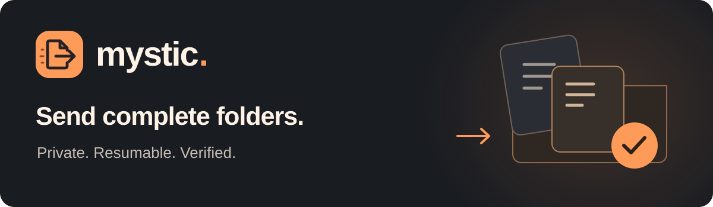
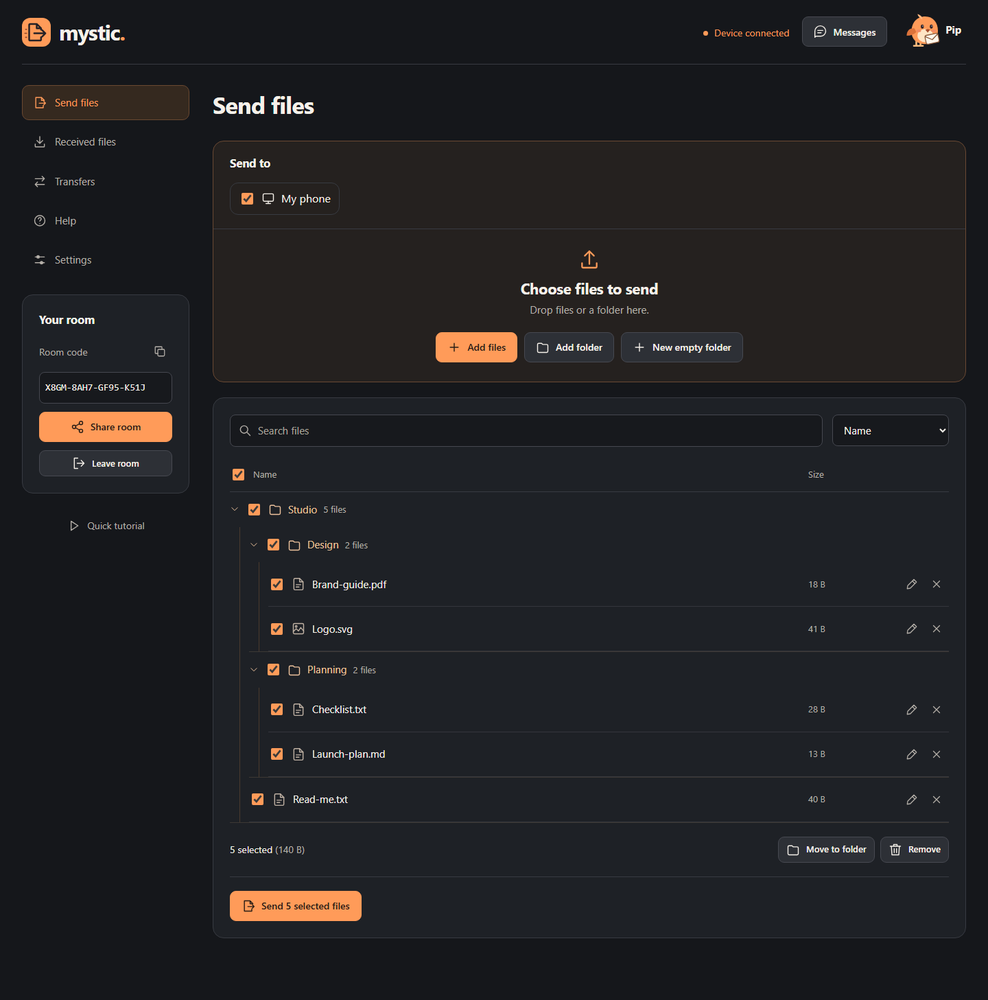
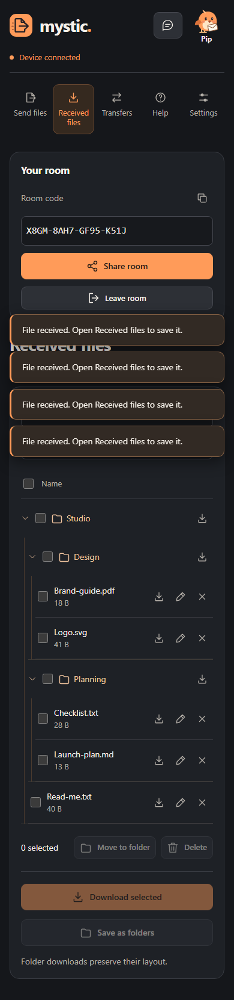

# Mystic

<p align="center"></p>

<p align="center">
  <a href="https://github.com/mkamrul9/ghostLink/actions/workflows/ci.yml"></a>
  <a href="LICENSE"></a>
  <a href="https://nodejs.org/"></a>
  <a href="CONTRIBUTING.md"></a>
</p>

<p align="center"><strong>Private folder sharing, with a way back when a transfer stops.</strong><br>Open a room, choose recipients, and send. No account or phone number required.</p>

<p align="center"><a href="#features">Features</a> &middot; <a href="#quick-start">Quick start</a> &middot; <a href="#self-hosting">Self-hosting</a> &middot; <a href="CONTRIBUTING.md">Contribute</a> &middot; <a href="SECURITY.md">Security</a></p>



## Features

- **Complete folders.** Keep nested paths and empty folders, organize files before sending, and save received folders as ZIP64 archives or native folders where supported.
- **Durable resume.** Reconnect the same devices and reselect the original files. Mystic checks the saved prefix and sends the missing part. An unchanged file already saved on the receiver is verified without sending its payload again.
- **Verified delivery.** Completed files have matching full-file SHA-256 checksums. Exports are checked again; receipts record the result. Checksums verify bytes, not sender identity.
- **An encrypted local library.** On supported desktop browsers, receive directly into a folder you choose, outside browser-managed storage. Reopen that folder with its passphrase after clearing website data.
- **Private group rooms.** Up to six devices by default. Choose who receives your files; new arrivals stay unselected. Share room invites through your device, a messenger, email, or a copied code.
- **Large streaming downloads.** Native disk writers and browser-owned download streams avoid loading the whole file into memory on supported browsers.
- **Useful local tools.** Search, sort, rename, move, bulk selection, private room messages, encrypted portable backups, and separate history clearing.
- **Help without a subscription.** Pip, the courier-bird helper, explains the app and prepares commands such as `send report.pdf`. You review the files before sending. It runs locally without an AI service or API key.
- **A responsive workspace.** Phone, tablet, desktop, keyboard navigation, reduced motion, and touch-friendly controls.

<details>
<summary>See the mobile workspace</summary>
<br>

</details>

## Quick start

Install [Node.js 22 or later](https://nodejs.org/), then:

```sh
git clone https://github.com/mkamrul9/ghostLink.git
cd ghostLink
npm ci
npm start
```

Open **http://localhost:8080**. Create a room in one browser profile, join from another, and send a sample file. `localhost` links work only on the same computer. Use HTTPS to share with another device.

For development, use `npm run dev`. There is no frontend build step for normal operation.

### Send your first folder

1. Create a room and share its invite with the receiving devices.
2. On the sender, check the recipients in **Send to**.
3. Add files or a folder, then choose **Send**.
4. On the receiver, open **Received files** and download what you need.

For durable local storage, choose **Settings > Choose local folder** before receiving, and keep its passphrase. A local library is encrypted; use Mystic to open or export it. Existing browser files stay in browser storage when you switch locations. See the [local library guide](docs/local-library.md).

## What stays private

File contents, file names, messages, and AES keys travel over peer WebRTC channels. Mystic's Node server serves the application and relays connection handshakes. It has **no file-storage endpoint, accounts, or cloud backup**. A configured TURN relay forwards encrypted packets when a direct connection fails.

The signaling service is trusted for peer negotiation; Mystic does not independently authenticate peer identities. Share invites with people you trust. Without optional passphrase protection, people using the same browser profile can open browser-saved copies. Chat and transfer history are separate from file protection.

Read the [privacy and security model](docs/security-model.md) and [vulnerability reporting policy](SECURITY.md).

## Browser support and limits

Use a current browser with WebRTC and Web Crypto over HTTPS. Chrome and Edge on a computer provide the optional external-folder library. Other browsers can use browser storage and available streaming downloads. See [browser support](docs/browser-support.md).

- Both devices must stay online with Mystic open during a transfer. An installed browser web app does not remove this restriction.
- Browser storage remains subject to browser quotas. The optional external-folder library uses the selected drive instead; that drive still needs free space and permission.
- When neither native saving nor transferable-stream downloads work, a 256 MiB memory-download fallback prevents unbounded buffering.
- Browser-only copies require a saved download or backup after website data is cleared. External library copies can be reopened with their folder and passphrase. No passphrase reset is possible.
- Folder inputs on some browsers omit empty directories. Directory handles, dropped folders, and **New empty folder** preserve them.
- Restrictive networks may need TURN. A relay host must be configured; credentials alone do not create a relay.

## Self-hosting

The client and signaling service share one origin. Start with the [deployment guide](DEPLOYMENT.md): it covers Docker, HTTPS, free preview hosting, TURN, and release checks.

```sh
docker build -t mystic .
docker run --rm -p 8080:8080 mystic
```

For a Linux server with a domain and public IP, see [the HTTPS and relay stack](deploy/README.md). Keep secrets in the ignored deployment environment file. The project includes no production service or promised free relay capacity.

## Contribute

Contributions are welcome: code, browser testing, accessibility, documentation, and reproducible bug reports all help.

- Start with [CONTRIBUTING.md](CONTRIBUTING.md) and the [architecture guide](docs/architecture.md).
- Browse [good first issues](https://github.com/mkamrul9/ghostLink/labels/good%20first%20issue) or [help wanted](https://github.com/mkamrul9/ghostLink/labels/help%20wanted).
- [Report a bug](https://github.com/mkamrul9/ghostLink/issues/new/choose), [suggest a feature](https://github.com/mkamrul9/ghostLink/issues/new/choose), or ask in [Discussions](https://github.com/mkamrul9/ghostLink/discussions).
- Please follow the [code of conduct](CODE_OF_CONDUCT.md).

Small, focused pull requests are easiest to review. There is no contributor agreement to sign. Contributions use the existing ISC project license.

### Checks

```sh
npm ci
npx playwright install chromium
npm run verify
```

Verification includes protocol/storage tests, two-device sharing, encrypted backup recovery, local-folder recovery, four-device rooms, 750-file staging, a real 280 MiB transfer and streaming exports, and six responsive layouts. These are automated tests, not a claim of physical iOS/Android or hosted production-capacity testing. `npm run test:load` measures local signaling only.

Browser artifacts stay in ignored `test-results/`. Run `npm run docs:screenshots` to regenerate the sample screenshots. After changing the hash dependency, run `npm run build:crypto` and commit the generated bundle and license.

## Direction

Mystic focuses on **recoverable folder handoffs and user-owned encrypted storage**. Direct browser sharing is an established category; projects such as [PairDrop](https://github.com/schlagmichdoch/PairDrop) already do it well. We aim to make handing over a complete project and recovering it later straightforward, without claiming a feature nobody else has.

See the [roadmap](ROADMAP.md) and [product direction](PRODUCT.md). Features on the roadmap are proposals, not shipped capabilities or release promises.

## License

[ISC](LICENSE). Third-party notices are listed in [NOTICE.md](NOTICE.md).
