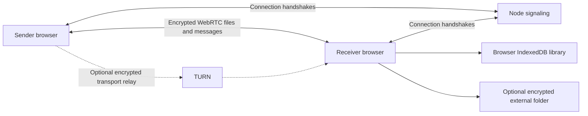

# Architecture

Mystic serves its browser client and signaling on the same Node origin. Runtime dependencies are deliberately small; normal deployment does not require a frontend compilation step or file-storage database.

## Modules

- `server.js`: static app routes, security headers, client configuration, health, room membership and targeted signaling. It accepts no upload or cloud-storage endpoint.
- `src/index.js`: application composition, user actions, settings and session lifecycle.
- `src/utils/RoomSession.js`: one WebRTC connection per room peer, recipient selection routing and room events.
- `src/utils/TransferManager.js`: per-file queue, protocol validation, crypto worker requests, durable chunk acknowledgements and resume credentials.
- `src/utils/FileReceiver.js`: committed prefix recovery, ordered packet writes, checksum state and verified completion.
- `src/DB/DBManager.js`: browser storage and routing to the active external-library backend. Browser and folder libraries remain separate.
- `src/utils/LocalFolderLibrary.js`: file-backed encrypted records, chunk files, master-key wrapping and exclusive writer lifecycle.
- `src/utils/SaveToDevice.js`, `StreamDownload.js` and `download-worker.js`: bounded native, browser-stream and legacy download paths.
- `src/utils/LocalBackup.js`: encrypted portable backup and transactional-style staged restore.
- `src/components/ui/`: plain JavaScript components with explicit store watchers.
- `src/worker/`: encryption and incremental sender hashing. The tracked `src/vendor/sha256.js` bundle is generated from `@noble/hashes`.

## Protocol invariants

Keep wire order through async key imports and storage writes. Never acknowledge a chunk before its committed resume position is durable. A resume hint is only a lookup aid: the full saved prefix and full completed file must be compared cryptographically.

File identifiers and peer identifiers serve different purposes. A new UI job can reuse an old wire file identifier for resume. User-visible progress and cancellation must map back to the correct job and peer.

The receiver's storage mode is selected by the user. Switching locations during activity is blocked. An external library has its own passphrase and preserved device identifier; changing a location does not migrate data.

## Tests and artifacts

`npm run verify` combines syntax/import checks, unit/integration tests and browser acceptance suites. `tests/browser-runtime.js` keeps browser profiles and downloads in the ignored workspace directory. README screenshots are generated from synthetic fixture files, not users' content.

See [CONTRIBUTING.md](../CONTRIBUTING.md) before changing storage, protocol or browser capability handling.
